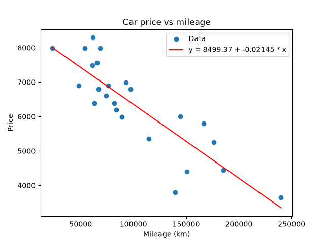

# ft_linear_regression — Car price prediction from mileage

A from-scratch implementation of **univariate linear regression**, trained with **gradient descent**, that estimates the price of a used car from its mileage.

The learned model has the form:

```
price = theta0 + theta1 × mileage
```
---

## Table of contents

1. [Project structure](#project-structure)
2. [Requirements](#requirements)
3. [Installation with Poetry](#installation-with-poetry)
4. [Data format](#data-format)
5. [Usage](#usage)
6. [How it works](#how-it-works)
7. [Visualization (`plot.py`)](#visualization-plotpy)
8. [Precision evaluation (`precision.py`)](#precision-evaluation-precisionpy)
9. [Design notes](#design-notes)
10. [Hyperparameters](#hyperparameters)
11. [`thetas.json` format](#thetasjson-format)
12. [Error handling](#error-handling)
13. [Limitations and possible improvements](#limitations-and-possible-improvements)

---

## Project structure

```

├── data.csv                   # Dataset (km, price)
├── thetas.json                # Learned parameters (generated by train.py)
├── pyproject.toml             # Project metadata and dependencies (Poetry)
├── poetry.lock                # Locked dependency versions (Poetry)
├── README.md
└── srcs/
   ├── linearRegression.py    # LinearRegression class (model + gradient descent)
   ├── predict.py             # Interactive prediction script
   ├── train.py               # Training script → writes thetas.json
   ├── plot.py                # Bonus: scatter plot of the data + regression line
   └── precision.py           # Bonus: precision metrics (MSE, RMSE, MAE, R²)
```

| File | Role |
|---|---|
| `linearRegression.py` | `LinearRegression` class: initialization, forward pass, cost, gradients, standardization, training, saving. |
| `train.py` | Loads `data.csv`, trains the model and saves `theta0` and `theta1` to `thetas.json`. |
| `predict.py` | Asks the user for a mileage and prints the estimated price using `thetas.json`. |
| `plot.py` | Displays the dataset as a scatter plot with the regression line computed from `thetas.json`. |
| `precision.py` | Measures how well the trained model fits the dataset (MSE, RMSE, MAE, R²). |

---

## Requirements

- Python **3.10+** (the code uses the `tuple[float, float]` annotation syntax, available from 3.9)
- [Poetry](https://python-poetry.org/) for dependency and virtual environment management
- Dependencies (managed by Poetry):
  - [NumPy](https://numpy.org/)
  - [pandas](https://pandas.pydata.org/)
  - [matplotlib](https://matplotlib.org/) — only needed by `plot.py`

> `plot.py` and `precision.py` import `get_thetas` from `predict.py` and `load_data` from `train.py`, so they must be run from the same directory as these files (and from the directory containing `data.csv` and `thetas.json`).

---

## Installation with Poetry

### 1. Install Poetry

The recommended way is [`pipx`](https://pipx.pypa.io/):

```bash
pipx install poetry
poetry --version
```

Other methods (official installer, etc.) are described in the [Poetry documentation](https://python-poetry.org/docs/#installation).

### 2. Install the project dependencies

If `pyproject.toml` and `poetry.lock` are already in the repository, a single command is enough:

```bash
poetry install
```

This creates an isolated virtual environment and installs the exact locked versions of all dependencies.

---

## Data format

`data.csv` must be located in the **directory you run the scripts from** and contain two columns named exactly `km` and `price`:

```csv
km,price
240000,3650
139800,3800
150500,4400
185530,4450
...
```

- `km`: car mileage (explanatory variable, `X`)
- `price`: car price (target variable, `y`)

Malformed lines are skipped (`on_bad_lines='skip'`).

---

## Usage

All commands are run through Poetry so that they use the project's virtual environment.

### 1. Train the model

```bash
poetry run python train.py
```

The script:
1. reads `data.csv`;
2. standardizes the mileage;
3. runs gradient descent (with early stopping: a `Converged after N iterations.` message is printed if the convergence criterion is met);
4. converts the parameters back to the original scale;
5. writes `thetas.json`.

### 2. Predict a price

```bash
poetry run python predict.py
```

```
What the mileage of your car?
>100000
The estimate price of your car is: 5934.12
```

*(Example output; the actual value depends on your dataset.)*

> ⚠️ If `thetas.json` does not exist (model not trained yet), `predict.py` falls back to `theta0 = 0` and `theta1 = 0`, so the predicted price is `0.00`. This is the behaviour required by the subject.

### 3. Plot the data and the regression line (bonus)

```bash
poetry run python plot.py
```

Opens a matplotlib window showing the dataset and the learned line. See [Visualization](#visualization-plotpy).

### 4. Evaluate the precision of the model (bonus)

```bash
poetry run python precision.py
```

```
theta0 = 8499.3739, theta1 = -0.021448
MSE  : 445645.27
RMSE : 667.57 (average error in price units)
MAE  : 557.83
R2   : 0.7330 (1.0 = perfect fit)
```

*(Example output; the actual values depend on your dataset.)* See [Precision evaluation](#precision-evaluation-precisionpy).

### Alternative: activate the virtualenv once

```bash
eval $(poetry env activate)
python train.py
python predict.py
python plot.py
python precision.py
```

> Recommended order: `train.py` first (it generates `thetas.json`), then any of the other scripts. Without `thetas.json`, `plot.py` and `precision.py` use `theta0 = 0` and `theta1 = 0`, so the line is flat at 0 and the metrics are meaningless.

---

## How it works

Training (`LinearRegression.fit`) follows these steps:

1. **Checks**: `X` and `y` are `np.ndarray` of the same length, `iterations > 0`.
2. **Standardization** of `X`: `X_std = (X - mean) / std`. This lets gradient descent converge quickly with a reasonable learning rate.
3. **Initialization**: `W` ≈ small random number (`randn × 0.01`), `b = 0`.
4. **Gradient descent loop**:
   - forward pass: `predictions = X_std · W + b`
   - mean squared error cost: `J = Σ(predictions − y)² / (2m)`
   - gradients `dW` and `db`
   - simultaneous update: `W ← W − α·dW` and `b ← b − α·db`
   - stop if `|cost_i − cost_{i−1}| < convergence_tol`
5. **Denormalization**: the parameters learned on standardized data are converted so they apply directly to a raw mileage:
   ```
   theta1 = W / std
   theta0 = b − theta1 × mean
   ```
6. **Saving** to `thetas.json`.

### Mapping to the subject's notation

| Code | Notation |
|---|---|
| `W` (after denormalization) | `theta1` (slope) |
| `b` (after denormalization) | `theta0` (intercept) |

The gradients implemented in `backward()` are exactly the ones given in the subject:

```
tmpθ0 = learningRate × (1/m) × Σ (estimatePrice(mileage[i]) − price[i])
tmpθ1 = learningRate × (1/m) × Σ (estimatePrice(mileage[i]) − price[i]) × mileage[i]
```

with `dW` ↔ `∂J/∂θ1` and `db` ↔ `∂J/∂θ0`, and both parameters updated simultaneously.

---

## Visualization (`plot.py`)

<p align="center">
  
</p>

`plot.py` is a bonus script that lets you check visually that the learned line fits the data.

It:
1. loads `data.csv` with `load_data` (from `train.py`);
2. reads `theta0` and `theta1` with `get_thetas` (from `predict.py`);
3. computes the line `y = theta0 + theta1 × x` over 100 evenly spaced points between the smallest and the largest mileage of the dataset;
4. displays the data points as a scatter plot and the regression line in red, with its equation in the legend.

```bash
poetry run python plot.py
```

| Element | Content |
|---|---|
| X axis | Mileage (km) |
| Y axis | Price |
| Blue points | The dataset (`data.csv`) |
| Red line | The regression line `y = theta0 + theta1 × x` |

The line is drawn on the **raw** mileage using the denormalized thetas, exactly as `predict.py` would compute it.
---

## Precision evaluation (`precision.py`)

`precision.py` is a bonus script that quantifies how well the model fits the dataset. It loads `data.csv` and `thetas.json`, computes the predicted price of every car (`theta0 + theta1 × km`) and compares it with the real price.

```bash
poetry run python precision.py
```

The `compute_metrics(y_true, y_pred)` function returns the following metrics (with `errors = y_pred − y_true` and `m` the number of samples):

| Metric | Formula | Meaning |
|---|---|---|
| **MSE** | `Σ errors² / m` | Mean squared error. Penalizes large errors heavily; in price². |
| **RMSE** | `√MSE` | Root mean squared error. Typical error in **price units**, easier to interpret than MSE. |
| **MAE** | `Σ \|errors\| / m` | Mean absolute error. Average gap between prediction and real price, less sensitive to outliers. |
| **R²** | `1 − SS_res / SS_tot` | Coefficient of determination. `1.0` = perfect fit, `0.0` = no better than always predicting the mean price. |

with `SS_res = Σ (y_pred − y_true)²` and `SS_tot = Σ (y_true − mean(y_true))²`.

> ℹ️ The metrics are computed on the **same data used for training** (there is no train/test split), so they measure the quality of the fit rather than the ability to generalize to unseen cars.

---

## Design notes

- **Standardization.** Mileages are of the order of 10⁵ while prices are of the order of 10³–10⁴. With raw mileages, the `theta1` gradient dominates the `theta0` gradient, forcing a tiny learning rate and very slow convergence. Training on standardized data and converting back afterwards yields the same line, much faster. The prediction program still uses the exact hypothesis `theta0 + theta1 × mileage` on the raw mileage.
- **No "all-in-one" fitting library.** Only NumPy (array maths) and pandas (CSV reading) are used for the model. Functions such as `numpy.polyfit` or scikit-learn's `LinearRegression` are intentionally **not** used. matplotlib is only used for display in `plot.py`.
- **Separation of concerns.** `predict.py` has no dependency on NumPy or on the model class; it only reads `thetas.json`. `plot.py` and `precision.py` reuse `get_thetas` and `load_data` rather than duplicating the file-reading logic, and they never retrain the model.

---

## Hyperparameters

Defined in `train.py`:

| Parameter | Default | Description |
|---|---|---|
| `rate` (`learning_rate`) | `0.1` | Learning rate α. Too large → divergence; too small → slow convergence. |
| `iterations` | `100` | Maximum number of gradient descent iterations. |
| `convergence_tol` | `1e-6` | Early-stopping threshold on the cost variation (constructor argument). |

Using the class directly:

```python
import numpy as np
from linearRegression import LinearRegression

X = np.array([240000, 139800, 150500, 185530])
y = np.array([3650, 3800, 4400, 4450])

model = LinearRegression(learning_rate=0.1, convergence_tol=1e-6)
model.fit(X, y, iterations=100)
model.save_thetas("thetas.json")
```

Using the metrics function directly:

```python
from precision import compute_metrics

metrics = compute_metrics(y, theta0 + theta1 * X)
print(metrics["R2"])
```

---

## `thetas.json` format

```json
{"theta1": -0.0211, "theta0": 8481.5}
```

*(Example values.)*

- `theta0`: estimated price at 0 km
- `theta1`: price change per kilometre (usually negative)

This file is read by `predict.py`, `plot.py` and `precision.py`.

---

## Error handling

- **Missing `data.csv`**: `load_data` raises a `ValueError` (`Error: no file found`).
- **Malformed CSV lines**: skipped (`on_bad_lines='skip'`).
- **Missing, empty or corrupted `thetas.json`**: `get_thetas` falls back to `theta0 = 0` and `theta1 = 0` (with a warning if the values are invalid).
- **Invalid mileage** (not a number, or negative): `predict.py` prints an error and asks again.

---

## Limitations and possible improvements

- **Single feature**: only mileage is used. Adding age, brand, etc. would require a multivariate version.
- **Linear assumption**: depreciation is often non-linear in mileage. The plot from `plot.py` and the R² from `precision.py` help to judge whether a straight line is appropriate.
- **Extrapolation**: a very high mileage can produce a negative price.
- **No train/test split**: the whole dataset is used for training and for the precision metrics, so they may be optimistic.
